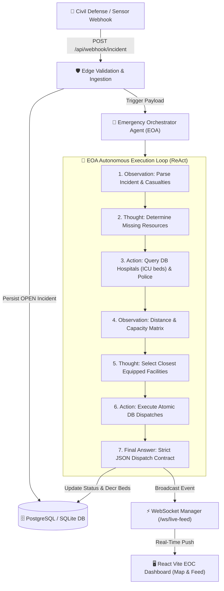

# 🚨 Emergency Operations Center (EOC) & Emergency Orchestrator Agent (EOA)

An autonomous, production-ready AI emergency dispatch and operations dashboard system. The system ingests critical incident payloads via edge webhooks, queries physical infrastructure using strict ReAct reasoning with zero hallucination, calculates Haversine routing to the closest equipped hospitals and police stations, reserves capacity in the database, and broadcasts live tactical dispatch feeds to a React Vite command dashboard over WebSockets.

---

## 🏗️ System Architecture



---

## 📂 Project Directory Structure

```
├── database.py             # Engine, sessionmaker, and get_db dependency
├── models.py               # SQLAlchemy 2.0 ORM Models with Joined Table Inheritance (ISA)
├── schemas.py              # Pydantic V2 schemas for input validation and strict JSON contracts
├── agent_engine.py         # Autonomous EOA ReAct engine, Haversine routing, and DB transactions
├── ws_manager.py           # WebSocket ConnectionManager for real-time live broadcasting
├── seed_db.py              # Database seeder with sample hospitals, police stations, and incidents
├── test_api.py             # Integration test suite for REST & WebSockets (4/4 passing)
├── test_eoa.py             # Unit test suite for agent tools and polymorphic queries (4/4 passing)
├── routers/
│   ├── __init__.py
│   ├── incidents.py        # Webhook entrypoint (POST /api/webhook/incident) & Incident endpoints
│   └── resources.py        # Live queries for Hospitals and Police Stations
├── main.py                 # FastAPI app, CORS configuration, and /ws/live-feed WebSocket
├── package.json            # Node.js dependencies for React, Vite, Leaflet, and Tailwind
├── vite.config.js          # Vite frontend configuration
├── tailwind.config.js      # Tailwind CSS configuration with tactical dark mode palette
├── index.html              # Frontend HTML root with Leaflet styling
└── src/
    ├── App.jsx             # React Router v6 and AuthProvider barrier
    ├── index.css           # Tailwind directives, Leaflet resets, and pulsing beacon animations
    ├── context/
    │   └── AuthContext.jsx # Frictionless terminal authentication & Device Token/SSO session
    ├── hooks/
    │   └── useWebSocket.js # Auth-gated WebSocket connection manager with keep-alive ping
    └── components/
        ├── Login.jsx           # Dark-themed tactical terminal login screen
        ├── ProtectedRoute.jsx  # Route guard redirecting unauthenticated users to /login
        ├── DashboardLayout.jsx # Main EOC screen (Live Map + Incident Feed + In-App Simulator)
        ├── DashboardStats.jsx  # Top HUD with live incidents, dispatches, and edge link status
        ├── LiveMap.jsx         # Leaflet map centered on Hebron with dynamic pulsing markers
        └── IncidentFeed.jsx    # Real-time stream of incoming AI dispatches and severity meters
```

---


```bash
pytest
```
**Results:** `8 passed in 1.15s ✅`
