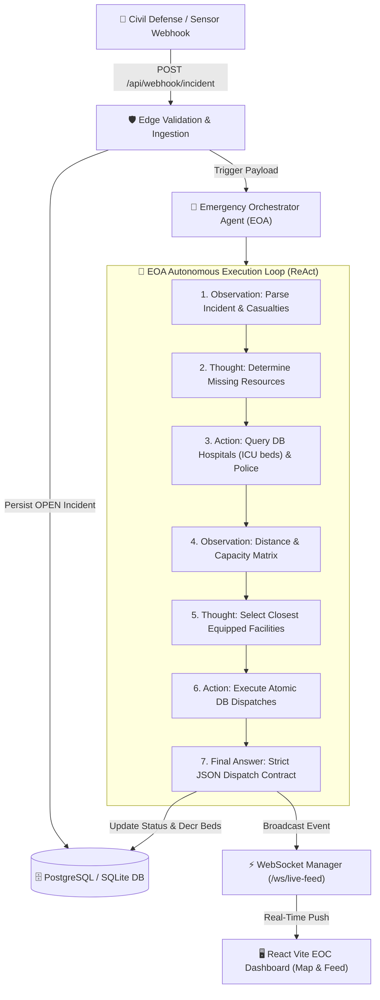

# 🚨 Emergency Operations Center (EOC) & Emergency Orchestrator Agent (EOA)

An autonomous, production-ready AI emergency dispatch and operations dashboard system. The system ingests critical incident payloads via edge webhooks, queries physical infrastructure using strict ReAct reasoning with zero hallucination, calculates Haversine routing to the closest equipped hospitals and police stations, reserves capacity in the database, and broadcasts live tactical dispatch feeds to a React Vite command dashboard over WebSockets.

---

## 🏗️ System Architecture



---

## 📂 Project Directory Structure

```
├── database.py             # Engine, sessionmaker, and get_db dependency
├── models.py               # SQLAlchemy 2.0 ORM Models with Joined Table Inheritance (ISA)
├── schemas.py              # Pydantic V2 schemas for input validation and strict JSON contracts
├── agent_engine.py         # Autonomous EOA ReAct engine, Haversine routing, and DB transactions
├── ws_manager.py           # WebSocket ConnectionManager for real-time live broadcasting
├── seed_db.py              # Database seeder with sample hospitals, police stations, and incidents
├── test_api.py             # Integration test suite for REST & WebSockets (4/4 passing)
├── test_eoa.py             # Unit test suite for agent tools and polymorphic queries (4/4 passing)
├── routers/
│   ├── __init__.py
│   ├── incidents.py        # Webhook entrypoint (POST /api/webhook/incident) & Incident endpoints
│   └── resources.py        # Live queries for Hospitals and Police Stations
├── main.py                 # FastAPI app, CORS configuration, and /ws/live-feed WebSocket
├── package.json            # Node.js dependencies for React, Vite, Leaflet, and Tailwind
├── vite.config.js          # Vite frontend configuration
├── tailwind.config.js      # Tailwind CSS configuration with tactical dark mode palette
├── index.html              # Frontend HTML root with Leaflet styling
└── src/
    ├── App.jsx             # React Router v6 and AuthProvider barrier
    ├── index.css           # Tailwind directives, Leaflet resets, and pulsing beacon animations
    ├── context/
    │   └── AuthContext.jsx # Frictionless terminal authentication & Device Token/SSO session
    ├── hooks/
    │   └── useWebSocket.js # Auth-gated WebSocket connection manager with keep-alive ping
    └── components/
        ├── Login.jsx           # Dark-themed tactical terminal login screen
        ├── ProtectedRoute.jsx  # Route guard redirecting unauthenticated users to /login
        ├── DashboardLayout.jsx # Main EOC screen (Live Map + Incident Feed + In-App Simulator)
        ├── DashboardStats.jsx  # Top HUD with live incidents, dispatches, and edge link status
        ├── LiveMap.jsx         # Leaflet map centered on Hebron with dynamic pulsing markers
        └── IncidentFeed.jsx    # Real-time stream of incoming AI dispatches and severity meters
```

---

## ⚡ Quick Start Guide

### 1. Database Initialization
Seed the database with sample emergency institutions (Hebron and Riyadh):
```bash
python seed_db.py
```

### 2. Start the Backend API (FastAPI)
Run the server using Uvicorn on Port 8000:
```bash
uvicorn main:app --reload --port 8000
```
- **Interactive Swagger Documentation:** [http://127.0.0.1:8000/docs](http://127.0.0.1:8000/docs)
- **Live WebSocket Feed:** `ws://127.0.0.1:8000/ws/live-feed`

### 3. Start the Frontend Dashboard (React + Vite)
In a second terminal, start the Vite development server on Port 5173:
```bash
npm run dev
# Or on Windows PowerShell:
npm.cmd run dev
```
Open **[http://localhost:5173](http://localhost:5173)** in your browser.

---

## 🔐 Authentication Flow

The system employs a frictionless terminal authorization model designed for high-stress operation rooms:
1. Open the login screen at `/login`.
2. Enter any valid Agency ID or click **`EOC-HEBRON-OPS`** / **`CIVIL-DEFENSE-911`** for 1-click terminal authentication.
3. Upon authorization, the session token is verified and the WebSocket live feed connects automatically.

---

## 📡 Testing the Incident Webhook

### Option A: Via the In-App Simulator
Click the red **`DISPATCH TEST INCIDENT`** button on the bottom-right of the dashboard map to submit incidents directly from the UI.

### Option B: Via cURL / PowerShell
```powershell
Invoke-RestMethod -Uri "http://127.0.0.1:8000/api/webhook/incident" -Method POST -Headers @{"Content-Type"="application/json"} -Body '{
  "type": "FIRE",
  "severity_level": 5,
  "description": "انفجار وحريق ضخم في مصنع للكيماويات في المنطقة الصناعية بالخليل. تم رصد 12 إصابة بحروق واختناق شديد تحتاج لعناية مكثفة فورية.",
  "lat": 31.5273,
  "lon": 35.0946,
  "required_beds": 12,
  "security_token": "valid_edge_token_998"
}'
```

### Option C: Sample JSON Response
```json
{
  "status": "DISPATCHED",
  "incident_id": 2,
  "incident_type": "FIRE",
  "severity_level": 5,
  "incident_summary": "انفجار وحريق ضخم في مصنع للكيماويات في المنطقة الصناعية بالخليل...",
  "coordinates": {
    "lat": 31.5273,
    "lon": 35.0946
  },
  "dispatches": [
    {
      "status": "success",
      "dispatch_id": 1,
      "incident_id": 2,
      "institution_id": 4,
      "institution_name": "Al-Ahli Hospital - Hebron (المستشفى الأهلي - الخليل)",
      "resource_type": "Ambulance Convoy & ICU Bed Reservation (12 Beds)",
      "eta_minutes": 2,
      "contact_info": "+970-2-222-7777"
    },
    {
      "status": "success",
      "dispatch_id": 2,
      "incident_id": 2,
      "institution_id": 8,
      "institution_name": "Industrial Zone Police & Security Patrols (مركز دوريات المنطقة الصناعية)",
      "resource_type": "Emergency Perimeter Patrol & Escort",
      "eta_minutes": 2,
      "contact_info": "+970-2-229-8888"
    }
  ],
  "response_time_eta_max_minutes": 2
}
```

---

## 🧪 Automated Test Verification

Run the comprehensive pytest suite verifying database models, agent tools, manual overrides, REST APIs, and WebSocket broadcasts:

```bash
pytest
```
**Results:** `8 passed in 1.15s ✅`
